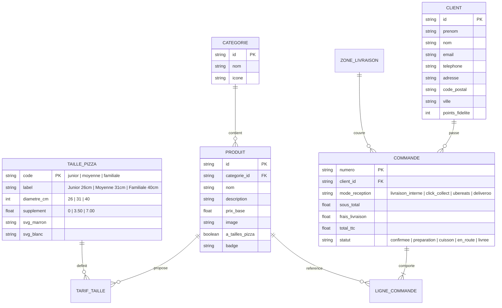

# PLAN COMPLET DU PROJET — O'PTI NOISY PIZZA (WEB MOBILE B2C)
**Formation :** BUT MMI3 - 2026 | **Module :** TP Web Mobile - Capacitor  
**Cahier des charges choisi :** N°3 — Site mobile de commande de pizzas avec paiement en ligne et livraison (BtoC)  
**Date limite de rendu :** Vendredi 23 Octobre 2026 avant 20h00  

---

## 1. Objectifs et Livrables Attendus

Le sujet demande de livrer **deux prototypes de sites web mobiles complets, amorcés (avec des données réalistes pré-chargées) et prêts à l'usage** :

1. **Livrable 1 — Version Bootstrap (`version-bootstrap/`)** :
   - Développé en **HTML5 / CSS3 / JS Vanilla / Bootstrap 5.3**.
   - Exploite le système de grille mobile Bootstrap, les composants natifs (`navbar`, `offcanvas`, `modal`, `carousel`, `card`, `badge`, `nav-pills`, `toast`, `form-floating`).
2. **Livrable 2 — Version W3C Native (`version-w3c/`)** :
   - Développé en **HTML5 / CSS3 / JS Vanilla pur (0 framework CSS)**, **100 % conforme aux standards W3C** (validateur HTML5 Nu Checker & validateur CSS3 W3C sans erreur).
   - Utilise CSS Grid, Flexbox, les variables CSS (`:root`), les balises sémantiques HTML5 (`<header>`, `<nav>`, `<main>`, `<section>`, `<article>`, `<aside>`, `<footer>`, `<dialog>`) et les attributs d'accessibilité ARIA.

---

## 2. Architecture des Dossiers du Projet

Pour éviter toute duplication inutile des images lourdes et garantir que les deux versions partagent exactement le même catalogue et les mêmes ressources :

```text
optinoisy-pizza-mobile/
├── PLAN_PROJET.md                        # Ce fichier de planification complète
├── index.html                            # Portail d'accueil permettant au correcteur de lancer la Version Bootstrap ou la Version W3C (avec aperçu mobile)
├── capacitor.config.json                 # Configuration Capacitor pour l'encapsulation mobile hybride
├── assets/
│   ├── icons/                            # Les 6 pictogrammes SVG officiels des tailles de pizzas
│   │   ├── picto-pizza-junior-26.svg
│   │   ├── picto-pizza-junior-26-blanc.svg
│   │   ├── picto-pizza-moyenne-31.svg
│   │   ├── picto-pizza-moyenne-31-blanc.svg
│   │   ├── picto-pizza-familiale-40.svg
│   │   └── picto-pizza-familiale-40-blanc.svg
│   └── img/                              # Les 9 visuels HD du ZIP
│       ├── OPTINOISY-visuel-intro1.jpg
│       ├── OPTINOISY-Mob-visuel-intro.jpg
│       ├── OPTINOISY-Mob-visuel-intro2.jpg
│       ├── OPTINOISY-Mob-visuel-intro3.jpg
│       ├── OPTINOISY-Mob-visuel-intro4.jpg
│       ├── OPTINOISY-Mob-visuel-intro5.jpg
│       ├── OPTINOISY-Mob-visuel-intro6.jpg
│       ├── OPTINOISY-Mob-visuel-intro7.jpg
│       └── OPTINOISY-Mob-salade-oceane.jpg
├── shared/
│   └── data.js                           # Base de données complète (Menu, Pizzas, Tailles, Zones GPS, Compte démo, Codes promos)
├── version-bootstrap/                    # LIVRABLE 1 : Prototype HTML/CSS/JS/Bootstrap
│   ├── index.html
│   ├── css/
│   │   └── custom-bootstrap.css
│   └── js/
│       └── app-bootstrap.js
└── version-w3c/                          # LIVRABLE 2 : Prototype HTML/CSS/JS/W3C Pur
    ├── index.html
    ├── css/
    │   └── style-w3c.css
    └── js/
        └── app-w3c.js
```

---

## 3. Identité Visuelle, Charte Graphique & Ressources du ZIP

### 3.1. Nom et univers de la marque
- **Nom de l'enseigne :** **O'Pti Noisy — Artisan Pizzaiolo & Four à Bois**
- **Positionnement :** Pizzeria artisanale généreuse et moderne basée à Noisy, proposant la commande directe en ligne (Click & Collect et Livraison interne géolocalisée) ainsi qu'une passerelle officielle vers **Uber Eats** et **Deliveroo**.
- **Particularité des photos du ZIP :** Toutes les photos `OPTINOISY-Mob-visuel-intro*.jpg` sont au format **portrait mobile (600×1110 px)** avec un **dégradé noir profond en partie haute**. Ce cadrage est spécialement conçu pour afficher le **Header mobile transparent, le logo et l'accroche directement par-dessus le haut noir de l'image** !

### 3.2. Palette de couleurs
| Rôle | Nom | Code Hex | Usage |
| :--- | :--- | :--- | :--- |
| **Primaire Sombre** | Noir Four | `#0D0B0A` | Fond principal des sections sombres et raccords avec le haut des photos `OPTINOISY-Mob` |
| **Surface / Carte** | Bois Brûlé | `#1A1412` | Fond des cartes produits, modales et barre de navigation mobile |
| **Brun Officiel SVG** | Brun Croûte | `#432918` | Couleur exacte extraite des fichiers `picto-pizza-*.svg` (utilisée sur fond clair/crème) |
| **Fond Clair Secondaire** | Crème Farine | `#FDF8F2` | Fond des pastilles de sélection de taille au repos (pour faire ressortir le SVG marron `#432918`) |
| **Accent Principal** | Rouge Pomodoro | `#E63946` | Boutons d'action principaux (Ajouter au panier, Commander, Taille sélectionnée) |
| **Accent Secondaire** | Or Mozzarella | `#F4A261` | Badges promos, étoiles d'avis, prix mis en avant |
| **Succès / Frais** | Vert Basilic | `#2A9D8F` | Validation de zone de livraison interne, statut "Ouvert", badges Végétarien |
| **Partenaire 1** | Vert Uber Eats | `#06C167` | Bouton et badge passerelle officielle Uber Eats |
| **Partenaire 2** | Turquoise Deliveroo | `#00CCBC` | Bouton et badge passerelle officielle Deliveroo |

### 3.3. Typographies (Google Fonts)
- **Titres & Prix (`--font-heading`) :** `'Outfit'` (700, 800) — Moderne, impactante sur écran mobile.
- **Texte & UI (`--font-body`) :** `'Plus Jakarta Sans'` (400, 500, 600, 700) — Lisibilité maximale sur smartphone.

### 3.4. Affectation exacte des 15 fichiers du ZIP

#### A. Les 6 Pictogrammes SVG de Tailles de Pizzas (`assets/icons/`)
> **Astuce UX majeure :** Chaque taille dispose d'une version **marron (`#432918`)** et d'une version **blanche (`#FFFFFF`)**.
> - **Bouton non sélectionné** (fond beige/crème `#FDF8F2`, texte `#432918`) $\rightarrow$ affiche le SVG **normal (`#432918`)**.
> - **Bouton sélectionné / actif** (fond rouge `#E63946` ou brun `#432918`, texte blanc) $\rightarrow$ affiche automatiquement le SVG **`-blanc.svg` (`#FFFFFF`)** !

| Taille | Diamètre | Parts / Convives | Fichier repos (Marron `#432918`) | Fichier actif (Blanc `#FFFFFF`) | Supplément Prix |
| :--- | :---: | :---: | :--- | :--- | :---: |
| **Junior** | **26 cm** | 1 pers. (6 parts) | `picto-pizza-junior-26.svg` | `picto-pizza-junior-26-blanc.svg` | **Prix de base (+0,00 €)** |
| **Moyenne** | **31 cm** | 1-2 pers. (8 parts) | `picto-pizza-moyenne-31.svg` | `picto-pizza-moyenne-31-blanc.svg` | **+3,50 €** |
| **Familiale** | **40 cm** | 3-4 pers. (12 parts) | `picto-pizza-familiale-40.svg` | `picto-pizza-familiale-40-blanc.svg` | **+7,00 €** |

#### B. Les 9 Visuels Photographiques (`assets/img/`)
| Fichier | Dimensions / Format | Contenu visuel | Utilisation dans le site mobile |
| :--- | :---: | :--- | :--- |
| `OPTINOISY-Mob-visuel-intro3.jpg` | Portrait Mobile | Pizza Bœuf haché, poivrons, olives noires sur planche en bois | **Slide Hero 1** + Visuel des pizzas *L'Orientale / La Bœuf Épicée* |
| `OPTINOISY-Mob-visuel-intro4.jpg` | Portrait Mobile | Part de pizza levée sur spatule avec fromage ultra-fondant et maïs | **Slide Hero 2** + Visuel des pizzas *4 Fromages Fondante / Margherita* |
| `OPTINOISY-Mob-visuel-intro7.jpg` | Portrait Mobile | Pizza Pepperoni & Champignons avec ambiance conviviale en arrière-plan | **Slide Hero 3** + Visuel des pizzas *Pepperoni / Reine / Menus Groupe* |
| `OPTINOISY-Mob-visuel-intro.jpg` | Portrait Mobile | Pizza Baguette entière gratinée + panier de frites sur planche | **Slide Hero 4** + Produit phare *Pizza Baguette Rustique & Frites* |
| `OPTINOISY-Mob-visuel-intro2.jpg` | Portrait Mobile | Pain Pita / Sandwich au four garni + panier de frites | Produit phare *Pain Pita du Four & Frites* (Catégorie Spécialités) |
| `OPTINOISY-Mob-visuel-intro5.jpg` | Portrait Mobile | Spaghetti Bolognaise maison enroulés à la fourchette | Catégorie **Pâtes Fraîches** (*Spaghetti Bolognaise*, *Penne Arrabbiata*) |
| `OPTINOISY-Mob-visuel-intro6.jpg` | Portrait Mobile | Salade fraîcheur avec crevettes sautées, roquette, tomates cerises, oignon rouge | Catégorie **Salades** (*Salade Gambas & Roquette*) |
| `OPTINOISY-Mob-salade-oceane.jpg` | Paysage / Carré | Salade composée avec thon, œufs durs, olives, concombre, tomates | Catégorie **Salades** (*Salade Océane Thon & Œuf*) |
| `OPTINOISY-visuel-intro1.jpg` | Paysage HD | Vue large pizza artisanale sur planche bois | Bannière promotionnelle / Fond du portail et des cartes Pizzas Spéciales |

---

## 4. Structure des Données (Modèle Logique & Catalogue `shared/data.js`)

### 4.1. Schéma des Entités (Mermaid)


### 4.2. Catalogue complet des produits (pré-amorcé dans `shared/data.js`)

#### Catégorie 1 : Pizzas Artisanales (avec sélecteur de taille 26 cm / 31 cm / 40 cm + choix base Tomate ou Crème + suppléments)
1. **La Noisy Spéciale (Bœuf & Poivrons)** — *Best-seller*
   - *Ingrédients :* Sauce tomate maison, mozzarella fior di latte, bœuf haché épicé, poivrons grillés, olives noires de Kalamata, origan.
   - *Tarifs :* Junior 26cm : **9,90 €** | Moyenne 31cm : **13,40 €** | Familiale 40cm : **16,90 €**
   - *Image :* `OPTINOISY-Mob-visuel-intro3.jpg`
2. **L'Ultra Fondante 4 Fromages** — *Gourmande*
   - *Ingrédients :* Base tomate ou crème fraîche, double mozzarella fondante, gorgonzola AOP, chèvre affiné, emmental, maïs doux, brin de romarin.
   - *Tarifs :* Junior 26cm : **10,50 €** | Moyenne 31cm : **14,00 €** | Familiale 40cm : **17,50 €**
   - *Image :* `OPTINOISY-Mob-visuel-intro4.jpg`
3. **La Pepperoni Conviviale** — *Coup de cœur*
   - *Ingrédients :* Sauce tomate parfumée, mozzarella filante, généreuses tranches de pepperoni grillé, champignons frais de Paris.
   - *Tarifs :* Junior 26cm : **9,50 €** | Moyenne 31cm : **13,00 €** | Familiale 40cm : **16,50 €**
   - *Image :* `OPTINOISY-Mob-visuel-intro7.jpg`
4. **L'Authentique du Chef (Bœuf, Merguez & Œuf)** — *Recette Signature*
   - *Ingrédients :* Sauce tomate, mozzarella, bœuf haché mariné, rondelles de merguez, poivrons, olives noires, œuf fermier.
   - *Tarifs :* Junior 26cm : **10,90 €** | Moyenne 31cm : **14,40 €** | Familiale 40cm : **17,90 €**
   - *Image :* `OPTINOISY-visuel-intro1.jpg`
5. **La Chèvre-Miel & Noix** — *Végétarienne*
   - *Ingrédients :* Base crème fraîche légère, mozzarella, bûche de chèvre frais, miel doré, éclats de noix, roquette.
   - *Tarifs :* Junior 26cm : **9,90 €** | Moyenne 31cm : **13,40 €** | Familiale 40cm : **16,90 €**
   - *Image :* `OPTINOISY-Mob-visuel-intro4.jpg`
6. **La Reine Tradition**
   - *Ingrédients :* Sauce tomate, mozzarella, jambon supérieur de dinde, champignons frais, olives noires.
   - *Tarifs :* Junior 26cm : **8,90 €** | Moyenne 31cm : **12,40 €** | Familiale 40cm : **15,90 €**
   - *Image :* `OPTINOISY-Mob-visuel-intro7.jpg`

#### Catégorie 2 : Menus & Formules B2C
7. **Menu Solo Express (Midi & Soir)** — **12,90 €**
   - 1 Pizza Junior 26 cm (ou 1 Spécialité du Four + Frites) + 1 Boisson 33cl.
   - *Image :* `OPTINOISY-Mob-visuel-intro.jpg`
8. **Menu Duo Lovers** — **26,90 €**
   - 2 Pizzas Moyennes 31 cm au choix + 2 Boissons 33cl + 1 Salade à partager.
   - *Image :* `OPTINOISY-Mob-visuel-intro3.jpg`
9. **Menu Soirée Match (Familial 40 cm)** — **34,90 €**
   - 2 Pizzas Familiales 40 cm au choix + 1 Maxi Boisson 1,5L.
   - *Image :* `OPTINOISY-Mob-visuel-intro7.jpg`

#### Catégorie 3 : Spécialités du Four & Pâtes Fraîches
10. **Pizza Baguette Rustique + Panier de Frites** — **10,50 €**
    - Pain baguette artisanal façon pizza garni de mozzarella fondante, poulet mariné, poivrons et olives noires, servi avec frites croustillantes.
    - *Image :* `OPTINOISY-Mob-visuel-intro.jpg`
11. **Pain Pita Grillé au Four + Panier de Frites** — **9,90 €**
    - Pain pita maison cuit au four à bois, garni d'émincé de volaille, crudités fraîches, sauce fromagère, poivrons et olives, servi avec frites.
    - *Image :* `OPTINOISY-Mob-visuel-intro2.jpg`
12. **Spaghetti Bolognaise Maison** — **11,50 €**
    - Spaghetti al dente, sauce bolognaise mijotée 4h au bœuf frais, tomates San Marzano, persil plat et parmesan Reggiano.
    - *Image :* `OPTINOISY-Mob-visuel-intro5.jpg`

#### Catégorie 4 : Salades Fraîcheur
13. **Salade Océane (Thon & Œuf)** — **8,90 €**
    - Jeunes pousses, thon albacore émietté, œufs durs au piment doux, tomates cerises, concombre croquant, oignon rouge et olives de Kalamata.
    - *Image :* `OPTINOISY-Mob-salade-oceane.jpg`
14. **Salade Gambas & Roquette** — **10,90 €**
    - Roquette sauvage, queues de crevettes sautées à l'ail et piment doux, tomates cerises bicolores, lamelles d'oignon rouge, vinaigrette agrumes.
    - *Image :* `OPTINOISY-Mob-visuel-intro6.jpg`

---

## 5. Spécifications Fonctionnelles des 6 Modules Clés

### Module 1 : Navigation Mobile-First & Ergonomie "App Native"
- **Top Bar fixe :** Logo *O'Pti Noisy*, indicateur en direct du mode de livraison actif (ex : *"📍 Livraison Noisy (25 min)"*), bouton Compte Client.
- **Hero Slider Mobile :** Carrousel tactile présentant les offres phares avec les visuels `OPTINOISY-Mob-visuel-intro*`.
- **Barre de catégories horizontale "Sticky" :** Navigation rapide au pouce (*🔥 Pizzas*, *🍱 Menus*, *🥖 Four & Pâtes*, *🥗 Salades*).
- **Bottom Navigation Bar fixe (style application mobile iOS/Android) :**
  1. `🍕 Carte` (Catalogue & Tailles)
  2. `📍 Livraison` (Géolocalisation interne & Uber Eats / Deliveroo)
  3. `🛒 Panier` (Avec badge compteur dynamique et total en €)
  4. `👤 Compte` (Connexion / Inscription / Fidélité / Suivi commande)

### Module 2 : Sélecteur de Tailles de Pizzas (26 / 31 / 40 cm) & Personnalisation
- Sur chaque carte Pizza ET dans la fenêtre de personnalisation :
  - **3 boutons visuels interactifs** affichant les icônes SVG officielles :
    - **Junior 26 cm** (`picto-pizza-junior-26.svg` / `-blanc.svg`)
    - **Moyenne 31 cm** (`picto-pizza-moyenne-31.svg` / `-blanc.svg`)
    - **Familiale 40 cm** (`picto-pizza-familiale-40.svg` / `-blanc.svg`)
  - Dès que l'utilisateur touche une taille :
    1. L'icône passe à la version `-blanc.svg` sur fond coloré actif.
    2. Le prix affiché sur la carte se met à jour instantanément.
  - Option de personnalisation rapide : Choix de la base (*Sauce Tomate* ou *Crème Fraîche*) et suppléments (+1,50 € : *Œuf*, *Mozzarella Burrata*, *Chèvre*, *Chorizo*).

### Module 3 : Livraison avec Géolocalisation Interne
- **Point de départ (Pizzeria O'Pti Noisy) :** Centre de Noisy-le-Grand (`lat: 48.8486, lng: 2.5528`).
- **Bouton « 📍 Me géolocaliser automatiquement » :**
  - Appelle l'API standard `navigator.geolocation.getCurrentPosition()`.
  - Inclut aussi un **mode Simulation 1-clic** (très utile pour le professeur qui corrige depuis Vélizy ou son bureau !) avec 3 boutons rapides :
    - *Simuler position : Noisy-le-Grand (1,2 km — Zone Interne Gratuite)*
    - *Simuler position : Champs-sur-Marne (3,8 km — Zone Interne Standard)*
    - *Simuler position : Hors zone > 6 km (Bascule auto vers Uber Eats / Deliveroo)*
- **Carte interactive intégrée (Leaflet + OpenStreetMap) :**
  - Affiche le marqueur de la pizzeria O'Pti Noisy, le cercle du rayon de livraison interne (5 km), et le marqueur du client avec calcul automatique de la distance (formule de Haversine) et du temps estimé (ex: *22 min*).

### Module 4 : Passerelles Uber Eats & Deliveroo (BtoC)
- **Intégration double :**
  1. **Dans le sélecteur de mode de commande** : Le client peut choisir entre :
     - 🛵 **Livraison Interne O'Pti Noisy** (Frais : 0 € dès 15 € d'achat, sinon 2,50 € — Fidélité +10%)
     - 🛍️ **Click & Collect — Retrait au comptoir** (Prêt en 15 min — -10% sur la commande)
     - 🟢 **Passerelle Uber Eats** (Livraison par coursier Uber Eats)
     - 🔵 **Passerelle Deliveroo** (Livraison par coursier Deliveroo)
  2. **Modale / Passerelle dédiée Uber Eats & Deliveroo** :
     - Si le client est hors de la zone de livraison interne (> 5 km) ou s'il clique sur Uber Eats / Deliveroo, le site affiche une **passerelle interactive dédiée** qui transfère le récapitulatif de son panier vers la boutique officielle *O'Pti Noisy* sur **Uber Eats** (`https://www.ubereats.com/fr`) ou **Deliveroo** (`https://deliveroo.fr/fr/`) avec comparaison des délais et frais.

### Module 5 : Création de Compte & Espace Client
- **Onglet / Vue Compte complet avec 2 modes :**
  - **Mode Non Connecté :** Onglets basculables **Créer un compte** (Prénom, Nom, Email, Téléphone, Adresse de livraison, Mot de passe avec validation) et **Se connecter** + bouton **« ⚡ Connexion Démo Rapide (Client Test) »** pour permettre au professeur de tester immédiatement sans tout saisir.
  - **Mode Connecté :** Affiche le profil du client, sa carte de fidélité (*80 / 100 pts = 1 Pizza Junior offerte*), ses adresses enregistrées et l'historique de ses commandes.
- Persistance dans `localStorage` pour que le compte créé reste actif pendant toute la session.

### Module 6 : Panier & Paiement en Ligne + Suivi en Direct
- **Tiroir / Vue Panier :**
  - Liste des articles avec photo, taille de pizza choisie (26, 31 ou 40 cm), suppléments, boutons `+` / `-` / `🗑️`.
  - Code promo fonctionnel (ex : `MMI2026` = -15% immédiat).
  - Récapitulatif clair : Sous-total HT, TVA (10%), Frais de livraison selon géolocalisation, Total TTC.
- **Tunnel de Paiement en Ligne :**
  - Choix du moyen de paiement : **Carte Bancaire (CB / Visa / Mastercard)**, **Apple Pay**, **Google Pay**, ou **Redirection Passerelle Uber Eats / Deliveroo**.
  - Formulaire de carte bancaire interactif avec formatage automatique des 16 chiffres, date d'expiration `MM/AA`, cryptogramme `CVV` et bouton **« Pré-remplir CB de test »**.
- **Écran de Confirmation & Tracker Live :**
  - Après paiement, génération d'un numéro de commande unique (ex : `#OPN-2026-849`) et affichage d'une barre de progression en temps réel (*1. Commande payée $\rightarrow$ 2. Préparation & Four à bois $\rightarrow$ 3. Livreur géolocalisé en route*).

---

## 6. Différences Techniques : Version 1 (Bootstrap) vs Version 2 (W3C)

| Élément | Version 1 : `version-bootstrap/` | Version 2 : `version-w3c/` |
| :--- | :--- | :--- |
| **Framework CSS** | Bootstrap 5.3.3 CDN + Bootstrap Icons + `custom-bootstrap.css` | **Aucun framework** — 100 % CSS3 natif (`style-w3c.css`) avec variables CSS, Grid & Flexbox |
| **Grille & Layout** | `.container`, `.row`, `.col-12`, `.col-md-6`, `.d-flex`, `.sticky-top` | `<main>`, CSS Grid (`grid-template-columns: repeat(auto-fill, minmax(...))`), Flexbox natif |
| **Panier & Modales** | Composants `bootstrap.Offcanvas` et `bootstrap.Modal` | Balise standard HTML5 `<dialog>` + panneau latéral CSS accessible (`aria-hidden`, `role="dialog"`) |
| **Notifications** | Composant `bootstrap.Toast` | Notification Toast en CSS/JS natif avec `role="status"` et `aria-live="polite"` |
| **Validation W3C** | Standard Bootstrap | **Zéro erreur / Zéro warning** sur `validator.w3.org` (HTML5) et `jigsaw.w3.org/css-validator/` (CSS3) |
